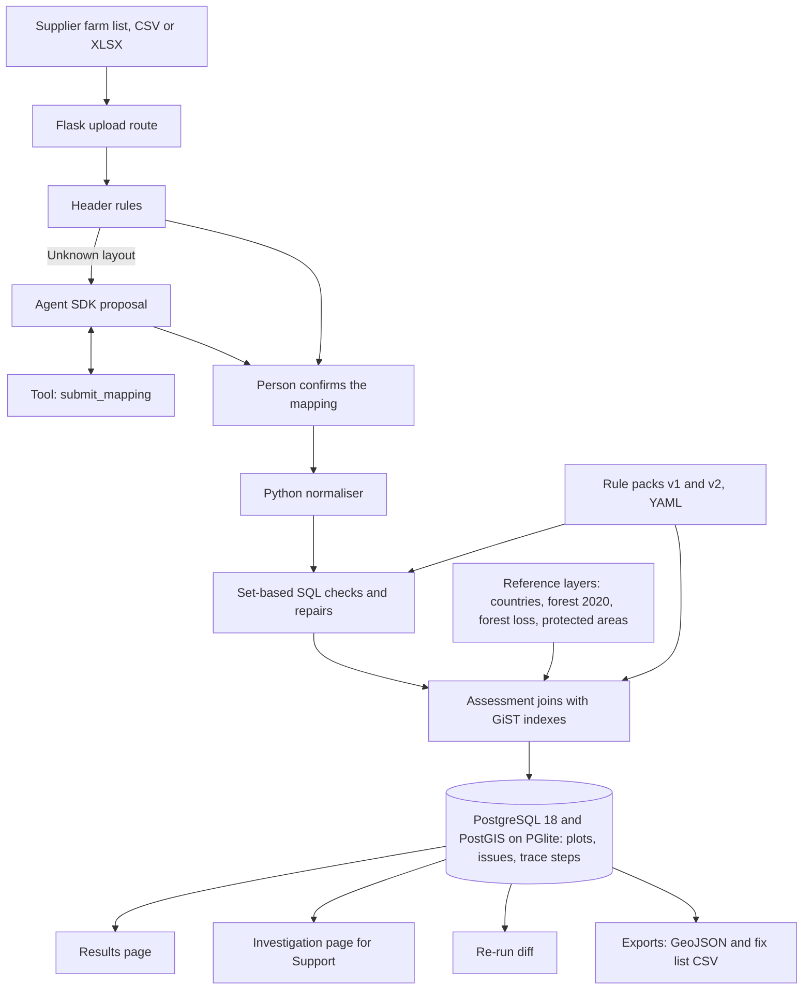

# Farm List Check

Takes a supplier's farm list (CSV or XLSX), maps its columns, validates and repairs every plot's geolocation in PostGIS, flags overlap with forest loss after the 31 Dec 2020 cut-off, and explains each verdict for Support.


Full video: https://github.com/ArchiusVuong-sudo/eudr-farmlist-check/releases/download/v0.1/demo.mp4

All data in this repo is synthetic. This is a prototype of farm-list intake checks, not a compliance tool.

## What it does

- Upload a messy farm list: Vietnamese or Spanish headers, decimal commas, degrees-minutes-seconds, UTM metres, swapped latitude and longitude, coordinates padded with zeros, broken polygons.
- Map the columns: header rules first; for an unknown layout a Claude Agent SDK proposal with a confidence and a reason per column, backed by a value check on each column. Nothing runs until a person confirms, and the confirmed mapping is saved for the next file with the same layout.
- Every plot ends Ready, Repaired (confirm with supplier), Review (forest loss or protected-area overlap) or Needs supplier fix, on a results map and a list of issues by rule, each with its citation or a "demo rule" tag.
- Support searches a plot code (try `DL-0137`) and gets the trace from the raw cells to the verdict: each transform with before and after, the candidate repairs tried, the checks that fired, the overlap evidence on a mini map, and a plain-English summary with the next step.
- Rule packs are versioned YAML. Re-running a list under `v2` (a simulated update) shows exactly which plots change and which rule key changed them; re-running `v1` gives the same result hash.
- Exports: GeoJSON of the Ready plots and a fix list CSV for the supplier.

## Architecture



## How it works

**Database.** The app runs real PostgreSQL 18 with PostGIS 3.6 compiled to WASM (PGlite), started by Python as a Node child process (`pglite-server`), so there is no Docker and no Postgres install. That server multiplexes one Postgres session, so the app keeps exactly one psycopg connection with auto-prepare off, takes a lock around each transaction, and never relies on session state. Model calls run outside the lock. All SQL lives in `sql/*.sql` and is loaded with aiosql; there is no ORM.

**Data model.** `farm_list` and `raw_row` keep the file as received (each cell's text, its Excel number format and type). `mapping_profile` stores confirmed mappings by header signature. `rule_pack` and `dataset_version` hold checksums of the rules and reference layers. Each `run` writes `plot` (given geometry, repaired geometry, assessed geometry, all with GiST indexes), `plot_issue`, `overlap_hit` and `trace_step`. Reference tables are `country`, `forest_2020`, `forest_loss` and `protected_area`.

**Reading cells.** Python parses the cells and keeps the text as shown, because precision checks need it: `12.683400` has six decimals on screen but four real ones, and an XLSX value of `12.6834` with the number format `0.000000` shows the same. A small WKT reader keeps every coordinate string and closes open rings. A cell that cannot be read becomes a row-level issue quoting the cell, and the batch carries on. PostGIS does all geometry math.

**Checks and repairs.** Fourteen set-based check statements run over the whole run at once, after set-based repairs: precision under six decimals, zero-padded precision, a point given for a plot over 4 ha, self-intersections repaired with `ST_MakeValid` (area before and after kept), rings closed, geodesic area against the declared area, implausible areas, duplicates, overlaps between plots, outside the declared country, protected-area overlap and forest loss after the cut-off. Swapped coordinates, dropped minus signs and UTM metres are repaired only when the point as given does not fit and exactly one candidate from the plpgsql function `coord_candidates` lands inside the declared country (Natural Earth outline, 100 m tolerance). Repaired plots go back to the supplier to confirm; they are never Ready.

**Assessment.** Plots are joined with the synthetic layers by `ST_Intersects` on GiST indexes after `ANALYZE`; the run page shows the plan line PostGIS printed. A point is assessed as an equal-area geodesic circle (`ST_Buffer` on geography) from its declared area, or from an assumed 1 ha under `v1`, recorded as an assumption. A loss patch counts when its overlap and confidence pass the rule pack's minimums.

**The model step.** Only column mapping uses a model, because a list from 30 countries can have headers in any language. The model sees the headers and a profile per column (kind, fill, numeric ranges, decimals, shape masks such as `Aa AAA-999`), never a cell value, so no names or plot codes leave the app. Its only way to answer is one in-process MCP tool, `submit_mapping`, whose input is validated against a pydantic schema and the file's headers; a bad answer is rejected and the model may try again within a few turns. Code then checks each proposed column against its values (a latitude column must read as latitudes or metres), and a person confirms. Each query runs in a child process with an allowlisted environment, no built-in tools, no settings files, strict MCP config, no session persistence, a temp working directory and the `dontAsk` permission mode. Overloaded, rate-limit and 5xx errors are retried with backoff; if the live call still fails, the app falls back to the recorded proposal and says so.

**Replay mode.** One provider interface has two implementations: live (Claude Agent SDK) and replay (responses recorded from real live runs into `fixtures/mapping/` by `scripts/record_fixtures.py`, with model id, date, time and cost). Replay is used when `DEMO_REPLAY=1` or no login or key is found, and the header shows a "Replay mode" badge. The recorded proposal for the Vietnamese sample came from `claude-sonnet-5-5` on 11 Oct 2026 (11.7 s, 3 turns, about $0.04).

**Evals.** `scripts/make_synthetic.py --seed 7` writes the two samples, the layers and an answer key per sample (problem codes and expected status per row under `v1` and `v2`). The run page scores each run against it. On the bundled samples: 31 of 31 injected problems found with 0 unexpected flags and 60 of 60 statuses for the Vietnamese list, 28 of 28 and 80 of 80 for the Colombian list, and the `v2` diff lists exactly the plots the key predicts (6 and 5).

**Trade-offs.** PGlite keeps the demo to `npm ci` and `uv sync`, at the cost of one connection and about 1.2 GB of memory for the database process; a production service would use a normal Postgres. Rules are data so a regulation change is a reviewed YAML diff with a re-run diff, not a code change. Repairs are conservative (one fitting candidate or none), and the plain-English summary is a template over the trace, so it cannot say anything the trace does not hold.

## Run it

Needs Node 20+ and [uv](https://docs.astral.sh/uv/) (Python 3.12 is installed by uv).

```bash
npm ci        # PGlite with PostGIS (the embedded database)
uv sync       # Python dependencies
make run      # live model if a Claude Code login or ANTHROPIC_API_KEY is found, else replay
make replay   # never calls the model: DEMO_REPLAY=1
```

Open http://127.0.0.1:4121, then "Use this sample" on `vn_htx_daklak.xlsx`. `make reset` deletes the local database (`var/pgdata`) and saved mapping profiles.

| Variable | Default | Meaning |
| --- | --- | --- |
| `PORT` | `4121` | Port on 127.0.0.1 |
| `DEMO_REPLAY` | unset | `1` uses the recorded proposals only |
| `FARMCHECK_MODEL` | `claude-sonnet-5-5` | Or `claude-opus-5-5`, `claude-haiku-5-5` |
| `ANTHROPIC_API_KEY` | unset | Optional; otherwise the local Claude Code login is used |
| `FARMCHECK_DATA_DIR` | `var/pgdata` | Where the embedded database keeps its files |

Other commands: `make data` rebuilds the synthetic samples and layers, `make fixtures` records the model proposals again from a live run.

## Tests

```bash
make test        # DEMO_REPLAY=1 uv run pytest (no network)
make test-live   # LIVE=1: one smoke test against the real model
```

The suite (70 tests) covers cell parsing (decimal commas, DMS, Excel number formats, WKT), header rules (the Vietnamese layout must map nothing by rules), column profiles that hold no cell values, the proposal schema and tool validation, the SDK isolation options, retries and the replay fallback, every rule firing on a row built to break it and on nothing else under `v1` and `v2`, the PostGIS functions (`coord_candidates`, `ha`, `ST_MakeValid`), and the main flow end to end through the web app for both samples: answer-key score, GiST index in the plan, equal-area circles within 1%, the `v2` diff, the result hash on re-run, the GeoJSON export parsed back and checked with `ST_IsValid`, and the fix list. Tests share one in-memory PGlite server per session. CI runs the same command (`.github/workflows/test.yml`).

## Notes

- All data is synthetic: producers (`Hộ SYN-001`, `Productor SYN-001`), communes, veredas, plots, forest cover, forest loss and protected areas are invented. Only province and department names and the Natural Earth country outlines (public domain) are real. The forest-loss layer is a synthetic stand-in for a detection model's output, not a model.
- `v2` is a simulated update for this demo, not an EU text. Legal parameters cite Regulation (EU) 2023/1115 (Art. 2(13) cut-off date, Art. 2(28) six decimals and polygons over 4 ha, Art. 9(1)(d) geolocation of all plots); every other threshold is a demo rule, not legal advice.
- Limits: two declared countries are set up (Vietnam, Colombia); one database connection; reference layers are loaded from GeoJSON at start; the map needs network for tiles.
- A production version would add a managed PostGIS with a connection pool and migrations, real reference layers with versioned imports, per-customer auth and audit logs, background jobs for large lists, and a review queue that records who confirmed each repair.
